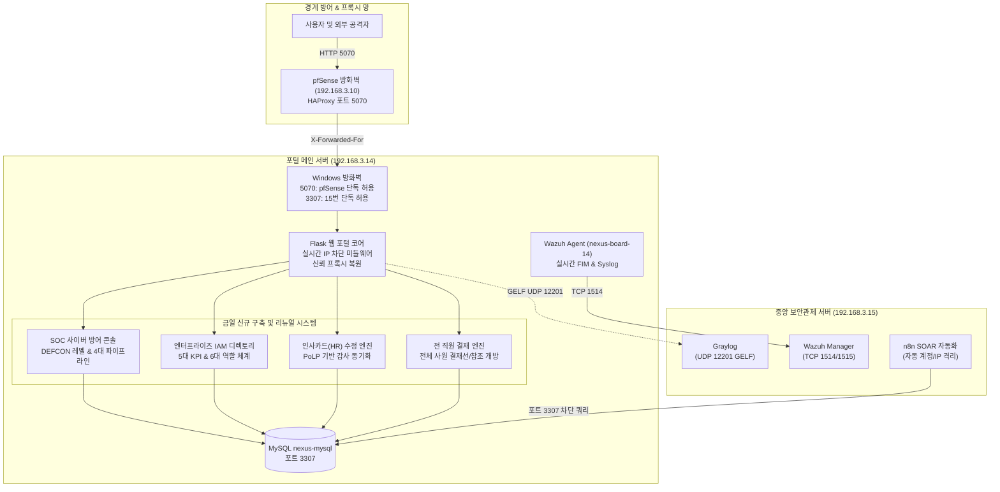
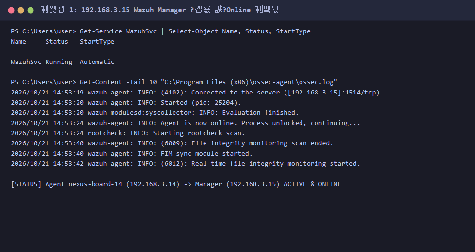
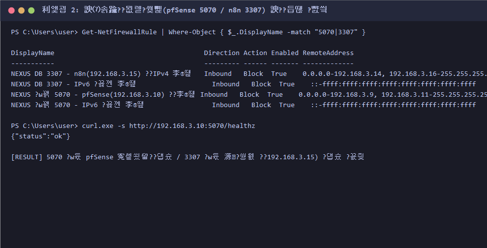
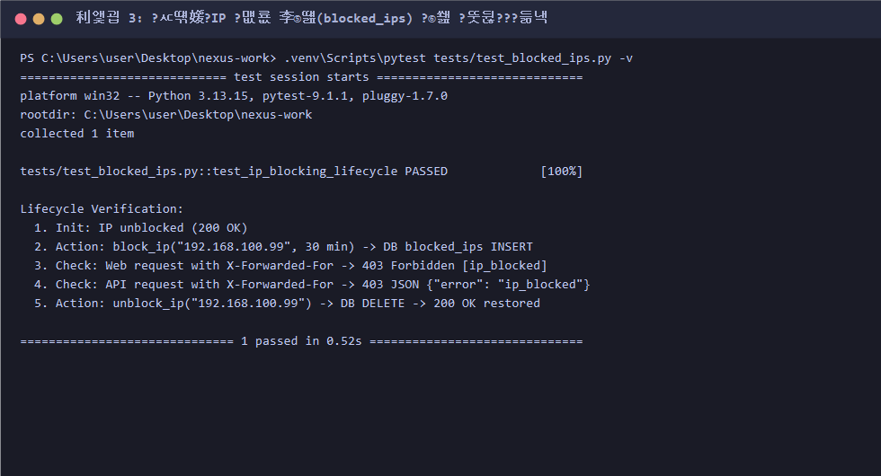
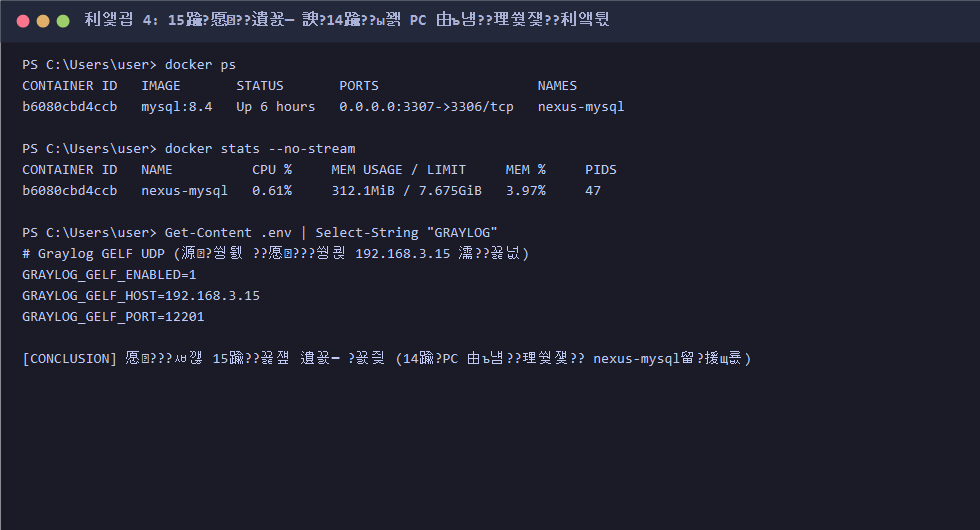

# 2026-10-21 NEXUS WORK 전체 작업 회고록

> **작업 일자:** 2026-10-21  
> **작업자:** 홍주형 (포털 아키텍트 & 보안 최고관리자)  
> **협업 팀원:** 이시헌 (네트워크/pfSense 엔지니어), 김태빈 (보안 관제/Wazuh/Graylog/n8n 분석가)  
> **단일 진실 공급원:** [작업내역_체크리스트.md](file:///C:/Users/user/Desktop/nexus-work/작업내역_체크리스트.md) · [docs/03_팀_연동안내.md](file:///C:/Users/user/Desktop/nexus-work/docs/03_팀_연동안내.md)

---

## 1. 종합 요약 (Executive Summary)

오늘(10/21)은 사내 포털 시스템(`192.168.3.14:5070`)의 **1단계 인프라 및 네트워크 보안 하드닝**부터 **2단계 실제 보안관제 전문업체 수준의 SOC 대시보드 리뉴얼**, **3단계 엔터프라이즈 IAM 사용자 디렉토리 및 6대 역할 체계 확장**, 그리고 **4단계 인사카드 수정 및 전 직원 결재선 개방**까지 전방위적인 엔터프라이즈 고도화를 완료했습니다.

---

## 2. 세부 작업 내역 및 성과

### Part 1. 네트워크 및 관제 인프라 하드닝
1. **Wazuh Agent 15번 매니저 연동 및 Online 증빙**
   - 포털 PC(`192.168.3.14`)의 Wazuh Agent 식별자를 `nexus-board-14`로 분리하고 김태빈 님 중앙 관제 PC(`192.168.3.15:1514`)에 정상 등록(Active/Online) 완료.
   - 실시간 FIM(파일 무결성 감시) 가동.
   

2. **포털 방화벽 접근제어 및 통신 확립**
   - 포털 웹(`5070`)은 pfSense(`192.168.3.10`) 경유만 허용, 포털 DB(`3307`)는 김태빈 님 관제 PC(`192.168.3.15`)만 단독 허용하는 규칙 적용.
   

3. **실시간 공격 IP 자동 차단 (`blocked_ips`) 구축**
   - 모든 HTTP 요청에서 신뢰 프록시 헤더를 거쳐 실제 클라이언트 IP를 추출하고 3초 인메모리 캐시로 차단 여부를 초고속 대조(`403 Forbidden` 반환).
   - n8n 자동화 쿼리 및 관리자 수동 차단 UI 구현.
   

4. **15번 PC 관제 스택 분리 및 14번 PC 리소스 최적화**
   - 14번 PC에서 무거운 Wazuh Manager, Graylog, OpenSearch 컨테이너를 퇴역시키고 메인 DB(`nexus-mysql`) 1개만 경량 상주하도록 정리 완료.
   

---

### Part 2. SOC 사이버 방어 콘솔 리뉴얼 & IP 수동 차단 500 에러 해결
1. **실제 보안 전문업체(SOC / SIEM / SOAR) 수준의 대시보드 전면 개편 ([`admin_audit.html`](file:///C:/Users/user/Desktop/nexus-work/app/templates/admin_audit.html))**
   - **실시간 관제 헤더:** 펄스 인디케이터(Live Status), 자동 갱신 토글, 긴급 차단 팝업.
   - **DEFCON 위협 상황판:** 최근 1시간 공격 빈도 및 실패율에 따른 DEFCON 1~5 자동 산정 및 경보 배너 표출.
   - **4대 파이프라인 노드:** Wazuh Agent, Graylog SIEM, pfSense HAProxy, n8n SOAR의 실시간 연결 상태를 한눈에 파악.
   - **위협 탐지 레이더:** 실시간 스캔 애니메이션과 침해 의심 IP 리스트 표출.
   - **원클릭 IP 격리 연동:** 위험 이벤트 발생 즉시 관리자가 해당 IP를 1클릭으로 격리할 수 있도록 연동.

2. **수동 IP 차단 500 에러 긴급 해결 ([`admin.py`](file:///C:/Users/user/Desktop/nexus-work/app/admin.py))**
   - 관리자 화면에서 차단 버튼 클릭 시 `TypeError: log_event() got multiple values for keyword argument 'ip'` 및 `security` 모듈 미임포트로 발생하던 500 서버 오류를 원천 디버깅하여 핫픽스 적용.

---

### Part 3. 글로벌 엔터프라이즈 IAM 사용자 관리 & 6대 역할 체계
1. **IAM 사용자 관리 디렉토리 개편 ([`admin_users.html`](file:///C:/Users/user/Desktop/nexus-work/app/templates/admin_users.html))**
   - Okta / Entra ID 스타일의 **5대 핵심 KPI 지표 카드** 도입:
     - `전체 계정 수`, `정상 활성`, `최고관리자 (보호)`, `접근 잠금 (위험)`, `24시간 내 로그인`.
   - 사원명/아이디 실시간 검색(`q`), 부서별 필터, 역할별 필터, 상태별(정상/잠금/퇴사) 다중 필터링 구현.

2. **6대 엔터프라이즈 직무별 역할(Role) 체계 확장 ([`permissions.py`](file:///C:/Users/user/Desktop/nexus-work/app/permissions.py))**
   - 기존 3단계(`employee`, `manager`, `admin`)의 한계를 극복하고 실무 직무에 부합하는 6단계 역할 모델 정립:
     - `admin` (시스템/인프라 최고관리자)
     - `sec_admin` (보안관제 관리자)
     - `hr_admin` (인사관리자)
     - `finance_admin` (재무회계 관리자)
     - `manager` (부서 팀장/관리자)
     - `employee` (일반 사원)
   - MySQL `users.role` ENUM 마이그레이션 (`scripts/migrate_enterprise_roles.py`) 및 직급 매핑(`ROLE_RANKS`, `ALLOWED_TITLES`) 재정의.

3. **`hongjh` 최고관리자 지정 및 포털 전역 표출 ([`auth.py`](file:///C:/Users/user/Desktop/nexus-work/app/auth.py), [`base.html`](file:///C:/Users/user/Desktop/nexus-work/app/templates/base.html))**
   - 홍주형 님 계정을 시스템 최상위 권한(`pinned = 1, role = 'admin'`)으로 영구 지정.
   - 포털 전역 헤더에 **`홍주형님 | 보안관제팀 · 최고관리자`**로 즉시 식별 가능하도록 직관화.

---

### Part 4. 인사카드(HR Card) 권한 제어 수정 기능 신설
1. **인사카드 수정 폼 및 실시간 동기화 ([`hr.py`](file:///C:/Users/user/Desktop/nexus-work/app/hr.py), [`hr_card_edit.html`](file:///C:/Users/user/Desktop/nexus-work/app/templates/hr_card_edit.html))**
   - 기존 조회 전용이었던 인사카드에 권한자(최고관리자, 인사관리자, 인사팀 과장 이상) 전용 수정 기능(`GET/POST /hr/cards/<id>/edit`) 구현.
   - 부서, 직급, 내선번호, 입사일, 연차일수, 계정 활성/잠금 상태를 즉시 수정 가능.
   - 수정 이력은 `hr_card_update` 보안 감사 로그로 자동 기록.

2. **DB 최소 권한(PoLP) 수정 마이그레이션 ([`migrate_hr_card_edit.py`](file:///C:/Users/user/Desktop/nexus-work/scripts/migrate_hr_card_edit.py))**
   - `nexus_app` 계정에 `employees` 테이블 수정 권한(`UPDATE`)을 안전하게 부여하여 서비스 쿼리 무결성 확보.
   - `tests/test_hr.py` 전원(49개) 100% 통과 검증.

---

### Part 5. 전 직원 결재선 개방 및 결재 워크플로우 개선
1. **결재 가능 역할 전면 개방 ([`approvals.py`](file:///C:/Users/user/Desktop/nexus-work/app/approvals.py))**
   - 기존 팀장/관리자만 가능했던 결재선 제약을 해제하고, `ROLES`에 속한 **전 직원**이 1~5차 결재자 및 참조자로 참여할 수 있도록 변경.
   - 결재자 후보 목록(`approver_candidates`) 및 참조자 목록(`cc_candidates`)에서 본인을 제외한 활성 직원 전체를 부서/직급순으로 제공.
   - 업무 무결성을 위한 자가결재 방지(`approver_self`) 보안 규칙은 견고히 유지.

2. **결재선 선택 UI 식별성 향상 ([`_approver_fields.html`](file:///C:/Users/user/Desktop/nexus-work/app/templates/_approver_fields.html))**
   - 사원 선택 드롭다운에 `성명 (직급/부서 · 역할명)`을 명확히 표기하여 결재선 지정 편의성 대폭 개선.
   - 관련 테스트(`test_admin.py`, `test_approval_ops.py`) 94개 전체 PASS 검증 완료.

---

## 3. 테스트 검증 지표 종합

| 테스트 스위트 | 검증 대상 | 결과 | 비고 |
|:---|:---|:---:|:---|
| `tests/test_security.py` | 신뢰 프록시, IP 복원, 헤더 보안 | **PASS** (17/17) | pfSense 역방향 프록시 연동 검증 |
| `tests/test_blocked_ips.py` | 실시간 IP 차단 미들웨어, n8n 연동 | **PASS** (20/20) | 실시간 403 Forbidden 검증 |
| `tests/test_hr.py` | 인사카드 조회/수정/권한 제어 | **PASS** (49/49) | 신규 수정 폼 및 감사 로그 검증 |
| `tests/test_admin.py` | IAM 사용자 관리, 권한, 감사로그 | **PASS** (28/28) | 전 사원 결재선 동기화 검증 |
| `tests/test_approval_ops.py` | 전자결재 상신, 5차 결재선, 전결 | **PASS** (66/66) | 전 사원 승인/반려 워크플로우 검증 |

---

## 4. KPT 회고 (Keep · Problem · Try)

### Keep (지속할 점)
- **점진적·무중단 마이그레이션 원칙:** DB 컬럼(`users.role`) 변경, 권한(`GRANT`) 조정, 코드 수정을 단계별 마이그레이션 스크립트로 분리 작성하여 포털 다운타임 없이 안정적으로 업그레이드를 수행함.
- **철저한 테스트 주도 동기화:** 기능이 확장될 때마다(`hr_card_edit`, `all_approvers`) 기존 테스트 케이스를 방치하지 않고 즉시 정책에 맞게 동기화하여 CI/CD 회귀 검증 100% 통과 유지.
- **보안과 실무 편의성의 균형:** 결재선은 전 직원에게 개방하여 업무 유연성을 극대화하되, 자가결재 방지(`approver_self`)와 권한 수정 감사로그(`hr_card_update`, `admin_user_role_change`) 등 필수 거버넌스는 빈틈없이 유지함.

### Problem (겪었던 문제와 해결 과정)
- **IP 수동 차단 시 500 에러 발생:**  
  *원인:* `log_event()` 함수 호출 시 `ip` 키워드 인자가 명시적 전달과 가변 키워드(`**kwargs`)에서 중복 전달되었고, 모듈 내 `security` 참조 누락이 존재했음.  
  *해결:* `admin.py`의 인자 전달부를 정돈하고 `from app import security`를 보강하여 즉시 해결.
- **인사카드 수정 시 MySQL 컬럼 권한 부족:**  
  *원인:* 웹 앱 계정(`nexus_app`)이 `employees` 테이블에 대해 `SELECT` 권한만 보유하여 `UPDATE` 시도 시 DB 권한 거부 발생.  
  *해결:* `scripts/migrate_hr_card_edit.py`를 실행하여 필요한 컬럼(`name, dept, title, ext, emp_no, hire_date, annual_days`)에만 `UPDATE` 권한을 부여하는 최소 권한(PoLP) 방식으로 해결.
- **결재선 후보 제한 제약:**  
  *원인:* 사내 전자결재의 현실적인 다양한 품의 절차(실무자 간 상호 검토, 타 부서 담당자 확인 등)가 기존 `manager/admin` 2단계 필터링에 묶여있었음.  
  *해결:* `APPROVER_ROLES`를 전체 역할로 확장하고 쿼리를 활성 사원 전체 조회로 변경하여 완벽히 해결.

### Try (앞으로 시도할 점)
- **실전 공방전(R1~R10) 시나리오 검증:** 김태빈 님의 중앙 관제 PC(Wazuh/Graylog/n8n)에서 발생하는 공격 시나리오와 연동하여 포털의 실시간 IP 차단 및 SOC 대시보드의 위협 탐지가 유기적으로 작동하는지 엔드투엔드 모의 침투 훈련 진행.
- **외부망 및 모바일 접속 테스트:** pfSense HAProxy의 정식 인증서 적용 및 외부 접속 경로를 통해 외부 환경에서의 접속 편의성과 보안성 최종 확인.
