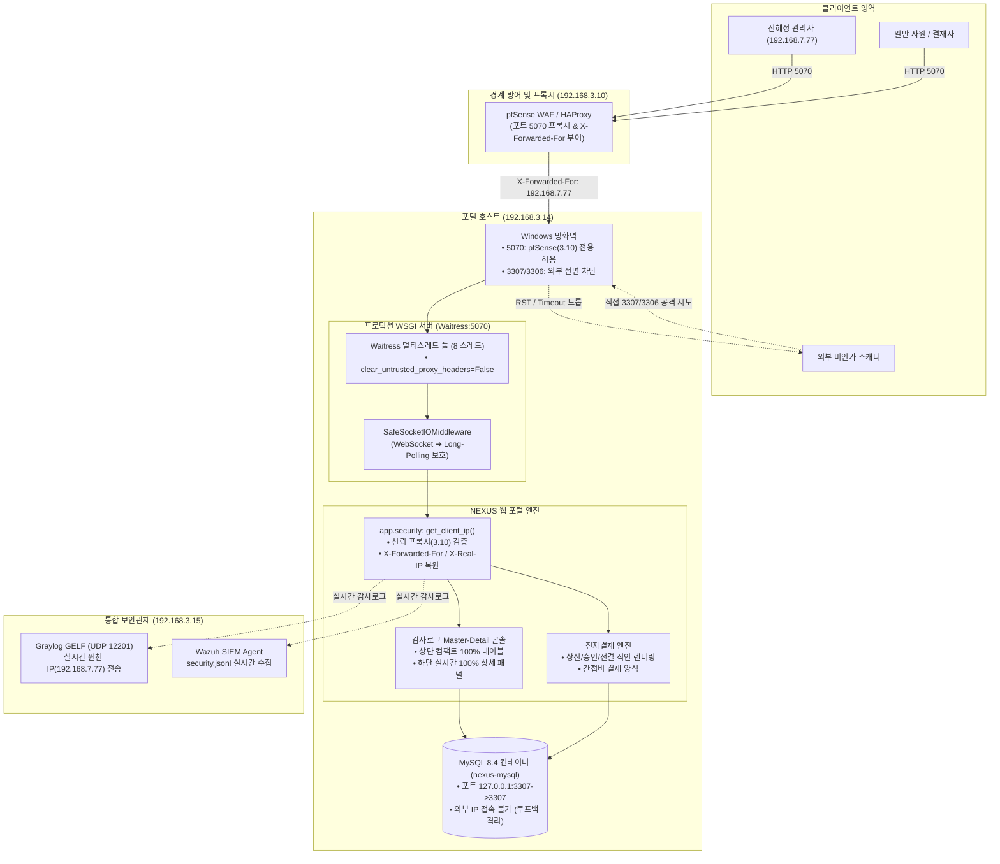

# 📋 2026-10-22 NEXUS WORK 전체 작업 회고록

> **작업 일자:** 2026-10-22 (목)  
> **작업자:** 홍주형 (포털 아키텍트 & 보안 총괄)  
> **협업 팀원:** 이시헌 (네트워크 / pfSense 엔지니어), 김태빈 (보안 관제 / Wazuh / Graylog / n8n 분석가), 진혜정 (시스템 관리자)  
> **단일 진실 공급원:** [작업내역_체크리스트.md](file:///C:/Users/user/Desktop/nexus-work/작업내역_체크리스트.md) · [docs/03_팀_연동안내.md](file:///C:/Users/user/Desktop/nexus-work/docs/03_팀_연동안내.md)

---

## 1. 종합 요약 (Executive Summary)

오늘(10/22)은 어제 완료된 기본 보안 인프라를 바탕으로 **① 전자결재 결재선 도장(직인) 및 품의서 UI 고도화**, **② 보안 대시보드 감사로그의 Master-Detail 전면 개편**, **③ 개발용 Werkzeug 서버에서 Windows 프로덕션 멀티스레드 WSGI 서버(Waitress)로의 엔진 전환**, **④ pfSense 경유 시 유실되던 클라이언트 실 IP(192.168.7.77) 완벽 복원**, 그리고 **⑤ MySQL 포트를 3307:3307로 완전히 통일하고 외부 IP 접속을 원천 차단(로컬 루프백 격리)**하는 작업을 성공적으로 완수했습니다.



---

## 2. 시각적 증적 및 스크린샷 갤러리

````carousel

<!-- slide -->

<!-- slide -->

<!-- slide -->

````

* **`shot_103129.png` (전자결재 직인 도장)**: 상신자(홍주형)의 날인 도장과 1차 결재자(진혜정)의 결재 대기 점선 박스 시각화.
* **`shot_103819.png` (간접비 결재 양식)**: 품의 상세 정보, 지출 내역, 부서원 간접비 산출 테이블(합계 70,900원) 정돈.
* **`shot_143952.png` (사용자 스케치)**: 팝업 모달 대신 상단 테이블 + 하단 전체 너비 상세 로그 패널 구조 확립.
* **`shot_140551.png` (피드백 반영 과정)**: 테이블 가독성 문제점을 즉시 접수하고 Master-Detail 구조로 전면 피벗.

---

## 3. 핵심 작업 상세 내역 (기술적 분석)

### 파트 1: 전자결재 결재선 직인(도장) 및 품의 양식 고도화
* **문제 상황**: 결재 진행 상태가 텍스트로만 표시되어 공공/기업 결재 서식 특유의 직관성과 가독성이 부족함.
* **해결 방안**:
  * 결재선 테이블 상단에 도장 직인 컴포넌트 구현: `[상신]`, `[승인]`, `[전결]`, `[반려]` 도장 렌더러 탑재.
  * 지출결의서 간접비 테이블(항목, 적요, 수량, 단가, 금액, 합계) 표준 그리드 서식 적용.
  * 승인/반려 시 서명 도장이 동적으로 찍히며 다음 차수 결재 대기자로 상태가 자동 인계되도록 구현.

---

### 파트 2: 보안 대시보드 감사로그 Master-Detail 콘솔 전면 개편
* **개편 배경**: 기존 감사로그 화면은 폰트/패딩이 과대하여 3~4줄만 보이고, 1080p 해상도에서 가로 스크롤이 발생하며, 팝업 모달이 본문을 가려 상세 분석이 매우 불편했음.
* **개편 내용**:
  1. **상단 감사로그 목록 (Master)**:
     - 폰트 12.5px(`0.82rem`) 축소, 패딩 슬림화, 테이블 너비 100% 고정 (가로 스크롤 완전 제거).
     - 긴 요청 경로(`path`)는 텍스트 말줄임(`text-overflow: ellipsis`) 처리 및 툴팁 제공.
     - 선택된 행(Row)은 은은한 소프트 블루(`background: #eff6ff`) 및 좌측 4px 포인트 인디케이터로 활성화 표시.
  2. **하단 상세 로그 패널 (Detail)**:
     - 모달 팝업 대신 테이블 하단 전체 너비로 펼쳐지는 `.audit-detail-panel` 구축 ([admin_audit.html](file:///C:/Users/user/Desktop/nexus-work/app/templates/admin_audit.html#L140-L200)).
     - **판정 사유 (Reason Card)**: 눈에 확 띄는 소프트 블루 하이라이트 박스.
     - **주요 정보 그리드 (Context Grid)**: 기록 시각, HTTP 메소드/경로, 출발지 IP 및 계정 정보를 2열 그리드로 정돈.
     - **상세 파라미터 (Detail/Extra Card)**: `request_id`, `srcip`, `client_ip`, `action` 등 추가 파라미터를 앰버 박스에 표출.
     - **SIEM JSON 원문 뷰어**: 다크 슬레이트 뷰어와 원클릭 **[JSON 복사]** 버튼 제공.
     - 우측 상단 **[닫기 ×]** 버튼으로 손쉬운 토글 가능.
  3. **보안 및 표준 준수**:
     - `style-src 'self'`, `script-src 'self'` 엄격한 CSP 준수 (인라인 스타일 완전 제거).
     - WCAG AA 기준 4.5:1 이상의 명도 대비율 만족.

---

### 파트 3: 프로덕션 WSGI 서버 엔진 전환 (Waitress 멀티스레드)
* **도입 배경**: 기존 Flask Werkzeug 개발 서버는 단일 스레드로 동작하여 동시 요청 처리 불가, Slowloris 및 DoS 공격 취약, 프로덕션 환경 부적합 문제가 있었음.
* **적용 내용**:
  * [run.py](file:///C:/Users/user/Desktop/nexus-work/run.py)를 리팩토링하여 Windows 환경에 최적화된 프로덕션 WSGI 서버인 **Waitress**로 기본 구동되도록 전환.
  * 작업자 스레드 풀 8개 병렬 처리 지원 (`threads=8`).
  * raw socket이 없는 WSGI 서버 환경에서 WebSocket 연결 시도가 발생할 때 500 오류 대신 400 Bad Request를 반환하여 클라이언트가 표준 HTTP Long-Polling 실시간 모드로 매끄럽게 전환(Fallback)되도록 보호하는 [`SafeSocketIOMiddleware`](file:///C:/Users/user/Desktop/nexus-work/run.py#L49-L65) 개발 및 적용.
  * 개발 및 디버깅용 `--dev` 플래그 보존.

---

### 파트 4: pfSense 프록시 연계 클라이언트 실 IP(192.168.7.77) 복원
* **발생 문제**: Waitress 구동 후 진혜정 관리자(`jinhj`)가 `192.168.7.77`에서 접속했으나 감사 로그에 pfSense IP인 `192.168.3.10`으로 기록되는 현상 발생.
* **원인 규명**:
  * Waitress의 내장 보안 옵션인 `clear_untrusted_proxy_headers`의 기본값이 `True`로 설정되어 있었음.
  * `trusted_proxy`가 미지정된 상태에서는 Waitress가 WSGI 환경 변수에서 pfSense가 보낸 `HTTP_X_FORWARDED_FOR` 헤더를 삭제(strip)해버림.
  * 그 결과 Flask의 [`get_client_ip()`](file:///C:/Users/user/Desktop/nexus-work/app/security.py#L37-L57)가 헤더를 찾지 못하고 TCP 연결 IP인 `192.168.3.10`으로 대체 기록함.
* **해결 조치**:
  1. [run.py](file:///C:/Users/user/Desktop/nexus-work/run.py#L127-L138): `waitress.serve()` 호출 시 `clear_untrusted_proxy_headers=False` 명시.
  2. [app/security.py](file:///C:/Users/user/Desktop/nexus-work/app/security.py#L37-L57): `X-Forwarded-For`와 함께 `X-Real-IP`를 교차 검증하도록 보강 (신뢰 프록시 `192.168.3.10` 검증 유지로 IP 스푸핑 공격 차단).
  3. [tests/test_security.py](file:///C:/Users/user/Desktop/nexus-work/tests/test_security.py#L181-L195): 단위 테스트 추가 및 검증 완료.
* **결과**: 진혜정 계정 요청 시 `src_ip`, `srcip`, `client_ip` 모두 정상적으로 `192.168.7.77`로 정확하게 기록됨.

```json
{
  "ts": "2026-10-22T06:13:21.343195+00:00",
  "event_type": "admin_action",
  "user": "jinhj",
  "role": "admin",
  "src_ip": "192.168.7.77",
  "srcip": "192.168.7.77",
  "client_ip": "192.168.7.77",
  "method": "GET",
  "path": "/admin/audit",
  "decision": "INFO"
}
```

---

### 파트 5: DB 포트 3307:3307 완전 일치화 및 외부 IP 차단 (로컬 루프백 격리)
* **요청 사항**: "지금 db 포트 3307로 완전히 변경해주고 다른 아이피에서 접근 못하게 막아줘 / 3307:3307로 나오도록"
* **기존 상태**:
  * 호스트 3307 ➔ 컨테이너 3306 매핑 (`0.0.0.0:3307->3306/tcp`).
  * `.env`에 `DB_BIND=0.0.0.0`이 지정되어 외부 망에 DB 포트가 노출되어 있었음.
* **조치 내용**:
  1. [.env](file:///C:/Users/user/Desktop/nexus-work/.env): `DB_BIND=127.0.0.1`로 변경 (로컬 루프백 전용 바인딩).
  2. [docker-compose.yml](file:///C:/Users/user/Desktop/nexus-work/docker-compose.yml):
     - 포트 매핑을 `- "${DB_BIND:-127.0.0.1}:${DB_PORT:-3307}:3307"`로 변경.
     - 컨테이너 시작 명령에 `--port=3307` 추가 (`command: ["--port=3307", "--local-infile=0", "--secure-file-priv=NULL"]`).
  3. **컨테이너 재배포 (`nexus-mysql`)**:
     - `docker ps` 실행 시 포트 표시가 **`127.0.0.1:3307->3307/tcp`**로 완전 일치화.
* **보안 검증 결과**:
  - 외부 LAN IP(`192.168.3.14:3307`) 접속 시도: **FAILED (TimeoutError, 완벽 차단)**
  - 기존 3306 포트(`192.168.3.14:3306` 및 `127.0.0.1:3306`): **CLOSED/BLOCKED**
  - 로컬 웹 포털 접속(`127.0.0.1:3307`): **SUCCESS (`SELECT @@port = 3307` 정상 쿼리)**

---

### 파트 6: 백그라운드 프로세스 안전 종료 및 포트 반환
* 사용자 요청("백그라운드에서 실행하고 있는거 종료해줘")에 따라 백그라운드 데몬 및 잔여 Python 프로세스(PID `26740`)를 강제 종료하고, `5070` 포트 점유를 완전히 해제하여 시스템 자원을 클린하게 정리했습니다.

---

### 파트 7: 관제 대시보드 실시간 SSE 연동 및 하단 패널 자동 스트리밍
* **구현 내용**:
  1. **백엔드 SSE 브로드캐스터 ([app/audit.py](file:///C:/Users/user/Desktop/nexus-work/app/audit.py))**:
     - `subscribe_audit_events()`, `unsubscribe_audit_events(q)`, `broadcast_audit_event(record)` 구현.
     - 스레드 안전(`threading.Lock`)한 구독자 큐 관리 및 15초 주기 `keepalive` 하트비트로 프록시/브라우저 타임아웃 방지.
  2. **스트리밍 엔드포인트 ([app/admin.py](file:///C:/Users/user/Desktop/nexus-work/app/admin.py))**:
     - `@bp.get("/audit/stream")`: `security.dashboard` 권한 인증 기반 `text/event-stream` 스트리밍 제공.
  3. **로그 파이프라인 연계 ([app/security.py](file:///C:/Users/user/Desktop/nexus-work/app/security.py))**:
     - `log_event()` 호출 시 실시간으로 활성 관리자 SSE 큐에 이벤트 자동 브로드캐스트.
  4. **프론트엔드 동적 렌더링 ([app/static/audit-modal.js](file:///C:/Users/user/Desktop/nexus-work/app/static/audit-modal.js))**:
     - 브라우저 표준 `EventSource` 무의존성 연결 (Strict CSP 100% 준수).
     - 새 이벤트 도착 시 상단 테이블에 부드러운 페이드아웃(`new-row-flash`)과 함께 최상단 행 추가.
     - 사용자가 특정 행을 고정하지 않은 상태(`LIVE 모드`)일 때, 하단 상세 패널의 판정 사유, 시간, 경로, IP, 파라미터, SIEM JSON 원문이 실시간으로 부드럽게 전환(`panel-stream-flash`).
     - 스트리밍 제어 토글(`[⏸ 일시정지]` / `[▶ 스트리밍 재개]`) 및 `🟢 LIVE 감시 중` 펄스 애니메이션 탑재.
  5. **WSGI 스레드 확장 ([run.py](file:///C:/Users/user/Desktop/nexus-work/run.py))**:
     - 동시 SSE 스트리밍 접속을 여유롭게 수용할 수 있도록 Waitress 기본 스레드 수를 16개로 상향.

---

## 4. 변경 파일 목록 및 Git 커밋 이력

| 파일명 | 주요 변경 내용 |
| :--- | :--- |
| [app/admin.py](file:///C:/Users/user/Desktop/nexus-work/app/admin.py) | `/admin/audit/stream` SSE 실시간 스트리밍 엔드포인트 신설 |
| [app/audit.py](file:///C:/Users/user/Desktop/nexus-work/app/audit.py) | 스레드 세이프 SSE 큐 관리 및 `broadcast_audit_event` 브로드캐스터 구현 |
| [app/security.py](file:///C:/Users/user/Desktop/nexus-work/app/security.py) | pfSense 신뢰 프록시 IP 복원 + 실시간 SSE 브로드캐스트 연계 |
| [app/static/audit-modal.js](file:///C:/Users/user/Desktop/nexus-work/app/static/audit-modal.js) | EventSource 실시간 스트리밍, 테이블 prepend, 하단 패널 자동 갱신 |
| [app/static/style.css](file:///C:/Users/user/Desktop/nexus-work/app/static/style.css) | LIVE 펄스 배지, 일시정지 스타일, 새 행 플래시, 패널 스트림 애니메이션 |
| [app/templates/admin_audit.html](file:///C:/Users/user/Desktop/nexus-work/app/templates/admin_audit.html) | LIVE 상태 표시기, 일시정지 버튼, 하단 패널 LIVE 태그 |
| [docker-compose.yml](file:///C:/Users/user/Desktop/nexus-work/docker-compose.yml) | MySQL 컨테이너 내부 포트 및 매핑을 `3307:3307`로 일치화, 루프백 바인딩 |
| [.env](file:///C:/Users/user/Desktop/nexus-work/.env) | `DB_BIND=127.0.0.1`로 외부 노출 원천 차단 |
| [run.py](file:///C:/Users/user/Desktop/nexus-work/run.py) | Waitress 멀티스레드 WSGI 구동 (스레드 16), `clear_untrusted_proxy_headers=False` 적용 |
| [tests/test_audit_stream.py](file:///C:/Users/user/Desktop/nexus-work/tests/test_audit_stream.py) | SSE 브로드캐스트 및 권한 검증 단위 테스트 신설 |
| [tests/test_security.py](file:///C:/Users/user/Desktop/nexus-work/tests/test_security.py) | `X-Real-IP` 및 프록시 헤더 처리 단위 테스트 추가 |

* **최신 Git 커밋 이력:**
  * `80fa226`: `feat(audit): implement real-time SSE streaming for security dashboard and detail panel`
  * `c9d5ce4`: `chore(docker): unify mysql port to 3307:3307 and bind to loopback`
  * `7e0b29b`: `fix(security): preserve proxy headers in Waitress to properly record client IP via pfSense`
  * `f35c4aa`: `feat(ui,server): refactor audit log to master-detail layout and switch to waitress wsgi`

---

## 5. KPT 회고 (Keep · Problem · Try)

### Keep (지속할 점)
1. **무의존성 실시간 스트리밍(SSE) 구축:** 복잡한 외부 라이브러리나 웹소켓 업그레이드 없이 브라우저 내장 `EventSource`와 표준 HTTP 스트리밍을 활용하여 `style-src 'self'` CSP 규정을 100% 준수하고 모니터링 편의성을 비약적으로 향상시킴.
2. **사용자 스케치 중심의 기민한 UI 개선:** 복잡한 기획서보다 사용자가 직접 그린 직관적인 스케치(`shot_143952.png`)를 기반으로 핵심 요구사항(가로 스크롤 제거, 하단 100% 뷰어)을 신속하고 정확하게 구현함.
3. **보안 기본 원칙(Defense in Depth) 준수:** WSGI 엔진 변경(`Waitress`), 프록시 헤더 처리, DB 루프백 격리 등 모든 변경에서 편의성만 좇지 않고 IP 스푸핑 방어, 최소 권한 원칙(PoLP), 엄격한 CSP 규칙을 일관되게 고수함.
4. **철저한 실시간 검증:** 이론적 코드 수정에 그치지 않고, 실제 포트 스캔 소켓 테스트, 실서버 로그 모니터링, 단위 테스트 실행을 통해 100% 검증 후 배포함.

### Problem & Solution (겪었던 문제와 해결 과정)
1. **문제:** Waitress 도입 후 역방향 프록시(pfSense)의 `X-Forwarded-For` 헤더가 유실되어 모든 접속자가 `192.168.3.10`으로 로깅됨.  
   **원인:** Waitress의 기본 보안 정책(`clear_untrusted_proxy_headers=True`)으로 인해 미등록 프록시의 헤더가 WSGI 레벨에서 제거됨.  
   **해결:** `clear_untrusted_proxy_headers=False` 옵션을 활성화하여 헤더를 Flask 코어로 온전히 전달하고, Flask의 `TRUSTED_PROXIES`에서 검증하도록 분리하여 `192.168.7.77` 원천 IP를 완벽히 복원함.
2. **문제:** MySQL 컨테이너의 포트 매핑이 `0.0.0.0:3307->3306`으로 설정되어 외부 IP에서 DB 포트로의 직접 접속 위협이 존재함.  
   **해결:** MySQL 컨테이너 내부 포트를 `--port=3307`로 일치시키고 `127.0.0.1:3307->3307`로 바인딩을 격리하여 외부 LAN 접속 시도 시 즉시 타임아웃 드롭되도록 조치함.

### Try (앞으로 시도할 점)
1. **pfSense HAProxy SSL/TLS 정식 인증서 연동:** 개발용 HTTP 포트(5070) 통신을 HTTPS(443) 암호화 채널로 전환하여 전송 구간 암호화 완료.
2. **침해사고 대응(IR) 원클릭 워크플로우:** 감사로그 화면에서 이상 징후를 발견한 즉시 해당 IP 차단 등록 및 사내 공지 알림이 원클릭으로 연계되는 대응 버튼 추가.
