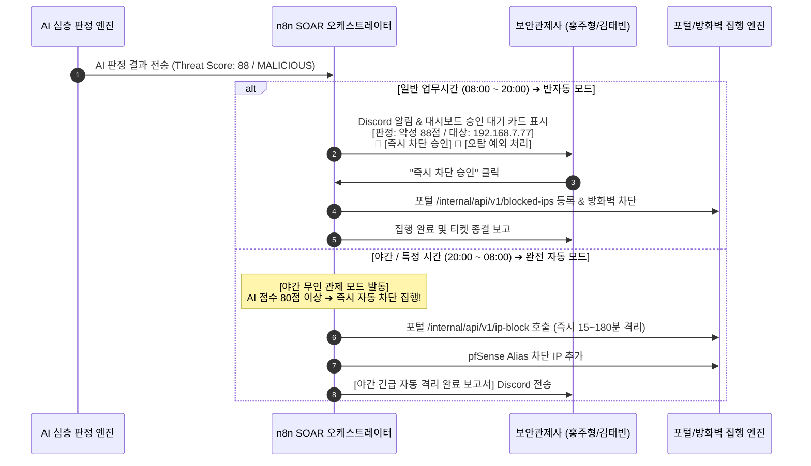

# 🛡️ NEXUS 차세대 AI-XDR 아키텍처 및 하이브리드 자동대응 기획안

> **문서 버전:** v2.0 (AI-Augmented XDR)  
> **기획자:** 홍주형 (포털 아키텍트 & 보안 총괄)  
> **협업 대상:** 김태빈 (보안 관제 / Wazuh / Graylog / n8n 분석가), 이시헌 (네트워크 / pfSense 엔지니어), 진혜정 (시스템 관리자)  
> **문서 목적:** 실시간 네트워크/웹 트래픽을 룰셋으로 1차 필터링한 후, **AI가 주기적으로 위협을 심층 판정**하며, **일반 시간(주간)은 반자동(승인형), 특정 시간(심야/부재중)은 완전 자동**으로 능동 대응을 집행하는 차세대 AI-SOC & XDR 파이프라인 수립

---

## 1. 추진 배경 및 핵심 콘셉트

### 1.1 기존 단일 룰 기반 관제의 한계
- **오탐(False Positive)과 알람 피로:** 정적 임계치(예: 5분 내 5회 실패 시 무조건 차단) 방식은 정상 사용자의 오타나 일시적 네트워크 오류까지 차단할 위험이 존재.
- **문맥(Context) 파악 불가:** 공격자가 탐지 룰을 회피하기 위해 시간 간격을 늘리거나 완곡한 표현으로 프롬프트 인젝션을 시도할 때 정적 룰은 무력화됨.
- **야간 관제 공백:** 24시간 상주 보안 인력이 없는 환경에서는 야간 침투 시 골든타임(Golden Hour)을 놓침.

### 1.2 사용자 요구사항 반영: AI 기반 하이브리드 XDR 콘셉트
```
1. [실시간 트래픽 수집] ➔ pfSense(네트워크) + 포털(웹/계정) + Wazuh(호스트) 실시간 스트림
2. [룰셋 1차 필터링]   ➔ R1~R12 및 디코이(허니팟) 시그니처로 의심 트래픽 급속 선별
3. [AI 주기적 심층 판정]➔ 걸러진 이벤트 버스트를 AI(Groq/Ollama)에 전달하여 공격 의도/위협도 종합 판정
4. [시간대별 대응 모드] ➔ 일반 업무시간: '반자동(Human-in-the-Loop)' / 심야·특정시간: '완전 자동(Zero-Touch)'
```

---

## 2. NEXUS AI-XDR 전체 아키텍처

```mermaid
flowchart TD
    subgraph Layer1_Traffic ["1. 실시간 트래픽 & 텔레메트리 (Ingestion)"]
        direction LR
        PFS["[Network] pfSense 트래픽<br/>• 방화벽 통과/드롭 트래픽<br/>• HAProxy HTTP 접근 로그"]
        WEB["[Web Portal] NEXUS 앱<br/>• 계정 인증 / 권한 검사<br/>• 디코이(/.env) 접근<br/>• AI 채팅 / 첨부파일 입력"]
        HOST["[Host/EDR] Wazuh Agent<br/>• FIM 소스코드/업로드 감시<br/>• 시스템 이상 프로세스"]
    end

    subgraph Layer2_RuleFilter ["2. 룰셋 1차 고속 필터링 (Rule-based Fast Filter)"]
        direction TB
        GL["Graylog Stream & Ruleset (R1~R12)<br/>• 비인가 시도 선별<br/>• 임계치 기반 의심 후보군 추출"]
        DEC["Decoy / Honeytrap Sensor<br/>• 비정상 스캔 즉시 태깅"]
    end

    subgraph Layer3_AIEngine ["3. AI 주기적 심층 판정 엔진 (AI Assessment Engine)"]
        direction TB
        Collector["이벤트 버퍼 & 컨텍스트 집계기<br/>(5분 주기 / 버스트 발생 시 트리거)"]
        AIBrain["NEXUS AI 보안 분석가 (Groq / Ollama)<br/>• 공격자 킬체인 의도 분석<br/>• 오탐 여부 검증 (정상 행위 배제)<br/>• 위협 점수(0~100) 및 신뢰도 산출"]
    end

    subgraph Layer4_HybridResponse ["4. 시간대별 하이브리드 대응 집행 (Hybrid Response Engine)"]
        direction TB
        TimeCheck{"시간대 판정<br/>(Scheduler / Time Gate)"}
        
        subgraph DayMode ["일반 업무 시간 (08:00 ~ 20:00)"]
            SemiAuto["[반자동 모드 (Semi-Auto)]<br/>• 관제 대시보드 권고 티켓 발행<br/>• Discord 알림 ('차단 승인' 버튼)<br/>• 보안관제사 확인 후 1클릭 집행"]
        end
        
        subgraph NightMode ["야간 / 주말 / 특정 시간 (20:00 ~ 익일 08:00)"]
            FullAuto["[완전 자동 모드 (Full-Auto)]<br/>• AI 위협점수 80점 이상 즉시 집행<br/>• 사전 격리 후 사후 보고 티켓 생성"]
        end
    end

    subgraph Layer5_Remediation ["5. 다계층 통합 격리 집행 (Multi-Tier Enforcement)"]
        Act_PFS["pfSense 방화벽 IP 차단 (Alias API)"]
        Act_Portal["포털 blocked_ips 등록 & 세션 즉시 만료"]
        Act_Wazuh["Wazuh 악성 파일 격리 / 프로세스 종료"]
    end

    Layer1_Traffic -->|Syslog / GELF| Layer2_RuleFilter
    Layer2_RuleFilter -->|선별된 의심 이벤트| Collector
    Collector --> AIBrain
    AIBrain -->|종합 판정 결과 (JSON)| TimeCheck
    TimeCheck -->|일반 시간| SemiAuto
    TimeCheck -->|야간/특정시간| FullAuto
    SemiAuto -->|관리자 승인| Layer5_Remediation
    FullAuto -->|즉시 자동 트리거| Layer5_Remediation
```

---

## 3. 세부 동작 프로세스

### 3.1 1단계: 룰셋 1차 필터링 (Fast Path)
대량의 정상 트래픽을 AI에 모두 보내면 API 비용 및 지연이 발생하므로, 기존 구축된 **Graylog 룰셋(R1~R12)**으로 1차 필터링합니다.

* **수집 대상:**
  - `R1/R5/R6`: 비정상 로그인 실패 및 계정 대입 의심
  - `R8`: 404 경로 대량 스캔
  - `R2`: 완화된 표현을 포함한 프롬프트 인젝션 의심
  - `R3/R11`: 기밀 문서 Tool 반복 호출 및 권한 거부
  - `Decoy`: `/.env`, `/backup.sql` 등 허니팟 타격

---

### 3.2 2단계: AI 심층 판정 엔진 (AI Deep Triage)
1차 필터링된 이벤트를 묶어(배치 윈도우 1~5분 또는 10건 이상 버스트 시) AI 분석 모델(Groq Llama-3.3-70b / Ollama qwen2.5)에 전달합니다.

#### AI 분석 프롬프트 및 응답 구조 (JSON Schema)
```json
{
  "assessment_id": "AI-TRG-20261026-0042",
  "attacker_ip": "192.168.7.77",
  "attack_type": "Multi-Stage Account Spray & Decoy Recon",
  "threat_score": 88,
  "confidence": 0.94,
  "verdict": "MALICIOUS", 
  "reasoning": "단순 오타가 아닌 5분 내 6개 서로 다른 계정 순차 대입 후 /.env 디코이 경로 접근 확인됨. 고의적 침투 시도로 판정.",
  "mitre_technique": ["T1110.003", "T1595.002"],
  "recommended_actions": [
    {"target": "portal", "action": "block_ip", "duration_minutes": 180},
    {"target": "pfsense", "action": "drop_ip"},
    {"target": "account", "action": "lock_targeted_users"}
  ]
}
```

---

### 3.3 3단계: 시간대별 하이브리드 대응 모드 (Daytime vs Nighttime)



| 구분 | 주간 / 일반 업무시간 (08:00 ~ 20:00) | 야간 / 특정 시간 (20:00 ~ 익일 08:00 & 주말) |
| :--- | :--- | :--- |
| **운영 모드** | **반자동 (Semi-Automated)** | **완전 자동 (Fully Automated)** |
| **의사 결정권** | **Human-in-the-Loop** (AI 분석 권고 + 관제사 최종 승인) | **Zero-Touch AI** (AI 판정 점수 기반 즉시 집행) |
| **대응 속도** | 승인 후 1초 내 집행 (평균 검토 1~2분 소요) | **실시간 즉시 집행 (< 2초)** |
| **오탐 방지책** | 관제사가 컨텍스트 및 AI 추론 근거 확인 후 승인 | • 화이트리스트(`192.168.3.10` 등) 원천 차단 방지<br/>• AI 점수 80점 이상 임계치 엄격 적용<br/>• 임시 차단(최대 30~60분) 후 관리자 출근 시 재검토 |

---

## 4. 포털 및 시스템 연동 구현 계획 (R&R)

### 4.1 포털 아키텍트 (홍주형) 과업
1. **실시간 트래픽/감사 스트림 연계**:
   - `/admin/audit/stream` (SSE)을 통해 실시간 수집된 트래픽 및 이벤트 버스트 감지.
2. **AI 판정 수신 및 하이브리드 대응 API 구축**:
   - 기존 구현된 `/internal/api/v1/blocked-ips` 및 `/internal/api/v1/ip-block` 활용.
   - 신규 관리 엔드포인트: `POST /internal/api/v1/ai-triage/approve` (주간 반자동 1클릭 승인용 API).
3. **시간대 판정 게이트 (`Time Gate`) 미들웨어**:
   - 현재 시각(KST)을 판별하여 `day` / `night` 모드 플래그를 n8n 및 보안 모듈에 전달.

### 4.2 보안 관제 / SOAR (김태빈) 과업
1. **1차 룰셋 필터 파이프라인 (Graylog)**:
   - R1~R12 및 디코이 탐지 이벤트를 모아 `AI_TRIAGE_QUEUE` Stream으로 라우팅.
2. **AI 심층 판정 워크플로우 (n8n)**:
   - 1~5분 주기로 큐의 이벤트를 집계하여 Groq/Ollama LLM API에 프롬프트 전송.
   - LLM 응답 JSON 파싱 후 위협 점수와 시간대 조건 분기 처리.
3. **Discord 인터랙티브 버튼 구축**:
   - 주간 모드 시 Discord Webhook에 `[차단 승인]`, `[오탐 무시]` 인터랙티브 웹훅 연동.

### 4.3 네트워크 / 방화벽 (이시헌) 과업
1. **pfSense 실시간 트래픽 수집 최적화**:
   - 방화벽 필터 로그 및 HAProxy 트래픽 로그를 Graylog로 실시간 유입.
2. **야간 자동 격리용 방화벽 Alias API 개방**:
   - 야간 모드 시 n8n이 공격 IP를 pfSense `URL Table` 또는 `pfBlockerNG`에 즉시 반영할 수 있는 인터페이스 연동.

---

## 5. 기대 효과

1. **오탐(False Positive)의 획기적 감축**:
   - 기존 정적 룰은 단순 실수도 기계적으로 차단했으나, AI가 페이로드와 연속 행동 문맥을 읽어 "오타인지 공격 의도인지"를 정확히 분별.
2. **24/7 빈틈없는 무인 방어 체계 실현**:
   - 관제 인력이 있는 주간에는 사람의 통제권(안전성)을 확보하고, 인력이 부재한 야간/주말에는 AI가 침투 즉시 선제 격리(신속성)를 수행하여 인프라 보호.
3. **공방전 및 최종 발표 평가 극대화**:
   - "단순 오픈소스 솔루션 나열"을 탈피하여, **"실시간 트래픽 필터링 ➔ 생성형 AI 심층 분석 ➔ 시간대별 지능형 능동 대응"**으로 이어지는 차세대 보안관제(AI-Driven SOC) 모델 완비.
