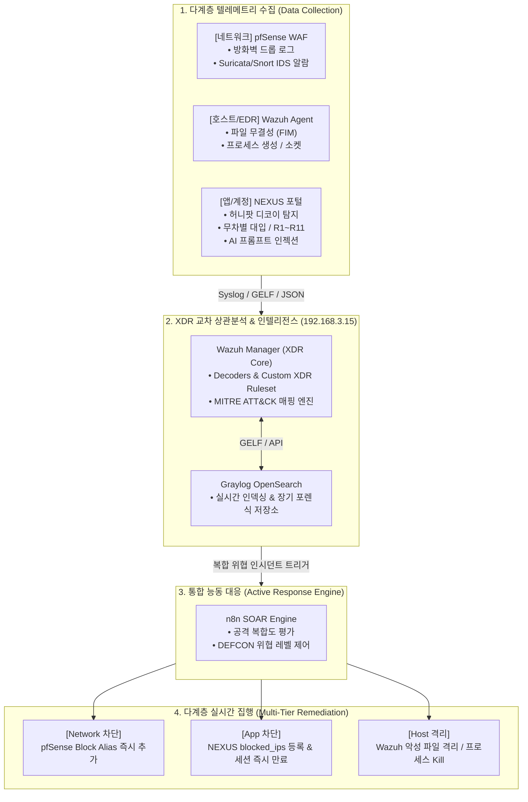
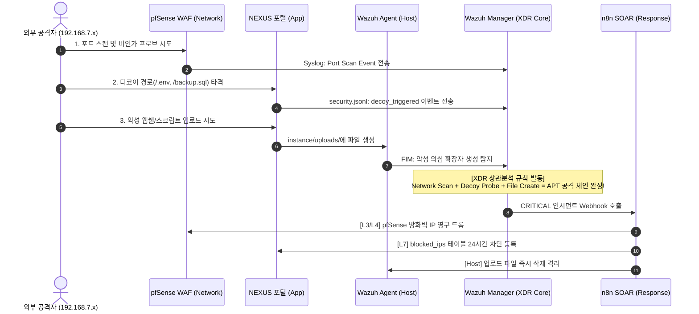
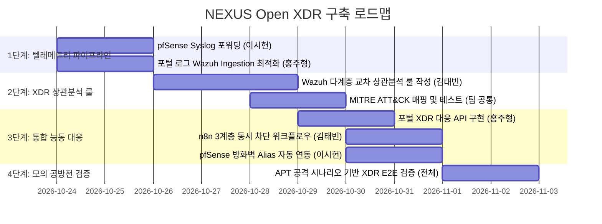

# 🛡️ NEXUS 오픈소스 XDR 아키텍처 구성 및 팀 연동 기획안 (초안)

> **문서 버전:** v1.0 (Draft)  
> **기획자:** 홍주형 (포털 아키텍트 & 보안 총괄)  
> **협업 대상:** 이시헌 (네트워크/pfSense 엔지니어), 김태빈 (보안 관제/Wazuh/Graylog/n8n 분석가)  
> **문서 목적:** 개별 운영 중인 WAF, EDR, SIEM, 웹 포털을 하나의 유기적 위협 탐지·대응 체계(**Open XDR**)로 통합하기 위한 기술 기획 및 팀원별 업무 분담(R&R) 정의

---

## 1. 추진 배경 및 필요성

### 1.1 현재 인프라의 한계 (보안 사일로화, Security Silo)
현재 NEXUS 인프라는 개별 보안 솔루션이 우수하게 구축되어 있으나, 각 솔루션이 파편화(Silo)되어 동작하고 있습니다:
* **네트워크(pfSense):** L3/L4 트래픽 차단 및 HAProxy 웹 방화벽 로그가 포털과 직접 교차 검증되지 않음.
* **호스트/EDR(Wazuh Agent):** 파일 무결성(FIM) 및 시스템 로그를 감시하지만, 웹 포털 내부의 허니팟(Decoy)이나 결재 권한 오용 이벤트와 직접 연계되지 않음.
* **웹 포털(NEXUS):** 자체 IP 차단(`blocked_ips`)과 감사로그(`security.jsonl`)를 운영하지만, 포털 외부 호스트 레벨의 악성 행위까지는 제어 불가.
* **관제/자동화(Graylog / n8n):** 수집 및 단일 규칙 기반 대응에 머물러 있어, **복합 다단계 공격(Multi-stage Cyber Kill Chain)**에 대한 전방위 상관분석이 부재함.

### 1.2 XDR(Extended Detection and Response) 도입 목표
* **다계층 텔레메트리 통합:** Network(pfSense) + Host/EDR(Wazuh) + App/Identity(NEXUS) 로그 단일 파이프라인 집결.
* **MITRE ATT&CK 기반 상관분석:** 단일 이벤트 단위가 아닌, 정찰(Recon) ➔ 침투(Initial Access) ➔ 권한상승(Privilege Escalation) ➔ 유출(Exfiltration)로 이어지는 공격 체인을 하나의 인시던트로 그룹화.
* **원클릭 / 전자동 통합 능동 대응:** 위협 판정 시 **[방화벽 IP 드롭 + 웹 세션 무효화 + 호스트 파일 격리]**가 1초 내 동시 집행되는 통합 대응 체계 구축.

---

## 2. NEXUS Open XDR 목표 아키텍처

기존에 구축된 **Wazuh(XDR 허브) + Graylog(SIEM) + n8n(SOAR) + pfSense(WAF) + NEXUS(웹 포털)**를 결합하여 추가 비용 없이 오픈소스 기반 엔터프라이즈 XDR을 완성합니다.



---

## 3. 핵심 기능별 세부 구현 계획

### 3.1 다계층 교차 상관분석 (Cross-Layer Correlation) 규칙 설계

단순 단일 룰이 아닌, **서로 다른 두 개 이상의 계층에서 연관 이벤트가 발생했을 때 상위 인시던트로 자동 승격**합니다.



#### XDR 복합 탐지 시나리오 예시
1. **[XDR-Rule-01] 정찰 및 취약점 침투 복합체인 (Severity: CRITICAL)**
   * 조건: pfSense에서 WAF 차단 발생 후 60초 이내에 동일 IP가 포털의 디코이 경로(`/.env`)를 호출한 경우.
   * MITRE 매핑: `Reconnaissance (T1595)` ➔ `Initial Access (T1190)`.
2. **[XDR-Rule-02] 내부 횡이동 및 데이터 유출 체인 (Severity: CRITICAL)**
   * 조건: 로그인 실패 3회 발생 후 우회 성공(R1) ➔ 비인가 기밀 문서 접근 ➔ 호스트 상에서 비정상 아웃바운드 소켓 연결 감지.
   * MITRE 매핑: `Credential Access (T1110)` ➔ `Lateral Movement (T1021)` ➔ `Exfiltration (T1041)`.
3. **[XDR-Rule-03] AI 인젝션을 통한 호스트 장악 시도 (Severity: HIGH)**
   * 조건: 포털 내 간접 프롬프트 주입 감지(`prompt_injection_observed`) ➔ AI Agent 도구 호출 거부 ➔ 호스트 프로세스 비정상 호출 시도.

---

### 3.2 통합 능동 대응 (Active Response & Remediation) 인터페이스

위협 발생 시 단일 API 호출로 3개 계층이 동시 방어에 돌입하도록 인터페이스를 표준화합니다.

```json
// n8n SOAR -> NEXUS 포털 능동 대응 웹훅 페이로드 예시
// POST /internal/api/v1/xdr/remediate
{
  "incident_id": "XDR-INC-20261023-001",
  "attacker_ip": "192.168.7.88",
  "threat_level": "DEFCON 1",
  "target_user": "kim",
  "actions": [
    {"type": "block_ip", "duration_minutes": 1440, "reason": "XDR correlated APT attack"},
    {"type": "revoke_session", "username": "kim"},
    {"type": "defcon_override", "level": "DEFCON 1"}
  ]
}
```

---

## 4. 팀원별 업무 분담 (R&R) 및 협업 로드맵

XDR 체계 구축을 위해 3개 파트가 유기적으로 연동되어야 합니다.

| 담당자 | 역할 | XDR 연동 주요 담당 과업 |
| :--- | :--- | :--- |
| **홍주형**<br>(포털 아키텍트) | **Application & Data Hub** | ① 포털 감사로그([`security.jsonl`](file:///C:/Users/user/Desktop/nexus-work/logs/security.jsonl)) 필드 표준화 (Wazuh 파서 친화형 CEF/JSON 규격 유지)<br>② SOAR 능동 대응 수신용 내부 API 개발 (`POST /internal/api/v1/xdr/remediate`)<br>③ 포털 감사로그 화면에 XDR 복합 인시던트 뷰 및 DEFCON 자동 연동<br>④ SSE 실시간 관제 스트림 유지 |
| **이시헌**<br>(네트워크/WAF) | **Network Telemetry & Edge Defense** | ① pfSense 방화벽 로그 및 HAProxy 접근 로그를 Syslog로 Wazuh/Graylog(`192.168.3.15`)에 포워딩<br>② pfSense 내 `pfBlockerNG` 또는 `URL Table Alias`를 구성하여 n8n이 공격 IP 목록을 실시간 푸시할 수 있도록 연동 엔드포인트 개방<br>③ 내부망 간 XDR 통신 포트 허용 (Syslog 514, Wazuh 1514, GELF 12201) |
| **김태빈**<br>(SOC 관제/SOAR) | **XDR Core & Orchestration** | ① Wazuh Manager(`192.168.3.15`)에 pfSense + Host + NEXUS 3계층 교차 상관분석 룰셋(XML) 작성<br>② Graylog 대시보드에 MITRE ATT&CK 기반 단일 뷰(Single-Pane-of-Glass) 파이프라인 구성<br>③ n8n에 **다계층 동시 격리 워크플로우** 구현 (pfSense IP 차단 + 포털 API 호출 + Discord/Slack 알림) |

---

## 5. 단계별 추진 일정 (4단계 로드맵)



---

## 6. 기대 효과 및 도입 후 이점

1. **사이버 킬체인 가시성 100% 확보:**
   * 단순 "포털에 로그인 실패 5회 발생"이 아니라, "외부 IP가 pfSense를 스캔하고 포털의 디코이를 거쳐 로그인 대입을 시도 중임"을 최초 단계에서 사전 인지.
2. **평균 침해 대응 시간(MTTR) 단축:**
   * 기존: 이상 징후 인지 ➔ 관리자 확인 ➔ 수동 방화벽/포털 차단 (수 분 소요).
   * 도입 후: 다계층 상관분석 ➔ n8n SOAR 즉시 트리거 ➔ **3개 계층 동시 차단까지 2초 이내 자동 완결**.
3. **평가 및 보고서 차별화:**
   * 단일 컴포넌트 방어를 뛰어넘어 **"네트워크(WAF) - 엔드포인트(EDR) - 애플리케이션(Web)이 유기적으로 통신하는 차세대 엔터프라이즈 XDR 아키텍처"**라는 최고 수준의 기술적 평가 획득 가능.

---

> [!TIP]
> **다음 액션 아이템:** 본 기획안을 바탕으로 팀 회의를 진행하여, 이시헌 님(pfSense Syslog 전송)과 김태빈 님(Wazuh 상관분석 룰셋 템플릿)의 기술 사양을 취합하고 1단계 텔레메트리 연동부터 착수하는 것을 추천합니다.
